# Phased Implementation Plan

> **Approach:** Follow `PROJECT_OVERVIEW.pdf` (p. 5) *"Build in Small Steps"* — establish exact tokens and Header + Hero reference fidelity before moving downward through the page, integrating real verified assets, wiring contact delivery, and finishing with a strict side-by-side reference QA pass.  
> **Current Status:** Documentation phase complete. **Do not begin Phase 1 until Phase 0 decisions & content approvals are reviewed by the human stakeholder.**

---

## 1. Phase Dependency Overview

```mermaid
flowchart LR
    P0["Phase 0: Approvals & Asset Intake"] --> P1["Phase 1: Tokens, Fonts & App Shell"]
    P1 --> P2["Phase 2: Header, Mobile Drawer & Hero"]
    P2 --> P3["Phase 3: About & Services Sections"]
    P3 --> P4["Phase 4: Projects, Testimonials & Counters"]
    P4 --> P5["Phase 5: Contact Form, Footer & Utilities"]
    P5 --> P6["Phase 6: Motion & Reduced-Motion Polish"]
    P6 --> P7["Phase 7: Side-by-Side QA, Audits & Vercel Deploy"]
```

---

## 2. Detailed Phase Breakdown

### Phase 0 — Human Approvals, Decisions & Asset Intake (Pre-Code Gate)

- **Objective:** Confirm proposed decisions and collect verified copy and imagery so zero placeholder fabrication enters the codebase.
- **Dependencies:** Review and approval of these seven `project-docs/` documents.
- **Confirmed Initial-Build Guardrails (Locked):**
  - Keep all 5 services (`CD-01`), keep Testimonials & Counters hidden until verified content is supplied (`CD-02`), omit the preloader (`CD-03`), install **no additional packages** (no GSAP, no Swiper — `CD-04`), and keep Contact email delivery unimplemented until destination email & provider are confirmed (`CD-05`).
- **Key Tasks:**
  1. Confirm **Proposed Decisions** (`PD-01`–`PD-05`, `DS-01`): verified Ashik color palette as design direction, navbar `BLOG` removal, `3+2` desktop services grid, `3 featured + 7-project archive` showcase approach, Hero secondary CTA target, and accessible nav hover contrast.
  2. Collect verified assets into `public/images/` and `public/icons/` (`PA-02`, `PA-03`):
     - Approved Hero portrait (+ optional 2nd About image if using Ashik's dual-image layout)
     - Approved 3:2 project screenshots/thumbnails for all 10 supplied projects
     - Approved brand logo/wordmark SVG and favicon
     - Optional approved CV PDF (only if Download CV CTA is selected)
  3. Collect verified text inputs for `src/data/` (`PA-01`–`PA-04`, `PA-06`):
     - Final Hero positioning statement & About bio
     - Exact verified experience wording (`5+ years` confirmation)
     - 10 project titles, roles/outcomes, and live URLs
     - Confirmed public contact details (if displayed) and verified social URLs
     - Optional verified Testimonials / Counters (kept hidden until supplied and approved)
  4. Record confirmation of Contact destination email and delivery provider (`PA-05`) whenever ready to unlock Stage 2 email delivery.
- **Completion Criteria:** Proposed design/layout decisions signed off; verified content/asset manifest ready (or explicit approval given to build visual shells first without deploying unfinished placeholders publicly).

---

### Phase 1 — Foundation: Tokens, Typography, Global Styles & Data Layer

- **Objective:** Configure the Next.js 16 shell, proposed Ashik design tokens, `Spline Sans` font loading, core UI primitives, and structured `src/data/` modules (using zero additional packages).
- **Dependencies:** Phase 0 (`PD-01` color direction sign-off).
- **Key Tasks:**
  1. Inspect `node_modules/next/dist/docs/` for Next.js 16 `next/font`, `metadata`, and `next/image` conventions.
  2. Update `src/app/globals.css`: remove boilerplate dark-mode override; define `:root` Ashik variables, Tailwind v4 `@theme inline` tokens, container utilities, smooth scroll + `scroll-margin-top`, and reduced-motion base rules.
  3. Update `src/app/layout.js`: replace `Geist` with `Spline_Sans` via `next/font/google`, configure accurate portfolio `metadata`, and add the accessible Skip Link.
  4. Create base `src/components/ui/` primitives (`Button.js`, `SectionHeading.js`, `Icons.js`, `SocialLinks.js`) matching `DESIGN_SYSTEM.md` geometry.
  5. Create `src/data/` files (`profile.js`, `navigation.js`, `services.js`, `projects.js`, `testimonials.js`, `counters.js`) using strictly verified information (leaving `testimonials` and `counters` as `[]`).
  6. Remove unused starter SVG boilerplate from `public/` (`next.svg`, `vercel.svg`, `globe.svg`, `file.svg`, `window.svg`) once replaced.
- **Testing Checkpoint:**
  - `npm run lint` and `npm run build` succeed with zero warnings/errors.
  - Browser DevTools confirms `Spline Sans` loads cleanly and computed body styles match `#ffffff` canvas, `#5e5f63` text, `16px / 28px`.
- **Completion Criteria:** Clean, warning-free foundation with verified tokens and zero starter Next.js template remnants.

---

### Phase 2 — Header, Mobile Drawer & Hero Section (Reference Anchor Milestone)

- **Objective:** Recreate Ashik's top-of-fold experience (`Header` + `MobileDrawer` + `HeroSection`) with faithful proportions before building any lower section.
- **Dependencies:** Phase 1 complete.
- **Key Tasks:**
  1. Build `Header.js` with transparent absolute default state (`pt: 30px`) transitioning smoothly to fixed sticky white state (`py: 15px`, drop shadow, `slideDown` animation) after scroll threshold.
  2. Build `MobileDrawer.js` (`300px` `#0f0f13` slide-in panel from left, dark backdrop, circular `51×51px` toggle, `Escape` dismissal, body scroll lock, focus management).
  3. Build `HeroDecoration.js` recreating Ashik's neon lime `#cdfe7d` geometric shapes and circular stroke cleanly in inline SVG.
  4. Build `HeroSection.js` (`#home`): uppercase `80px/96px` H1, verified role positioning, Primary & Secondary CTA buttons, and priority-loaded portrait image.
- **Testing Checkpoint:**
  - Side-by-side visual comparison against `https://wp.codeefly.net/ashik/` at `1440px`, `992px`, `768px`, and `375px`.
  - Verify Hero H1 wraps cleanly at `375px` (`36–40px`) with zero horizontal overflow.
  - Verify sticky header transitions cleanly and mobile drawer opens/closes via mouse and keyboard.
- **Completion Criteria:** Header and Hero match Ashik's visual balance, scale, spacing, and responsiveness across all breakpoints.

---

### Phase 3 — Core Narrative Sections: About & Services

- **Objective:** Implement the rounded `#f6f7f9` About showcase band and the elevated white Services grid for all 5 verified services.
- **Dependencies:** Phase 2 visual sign-off; `PD-03` (`3+2` desktop grid sign-off).
- **Key Tasks:**
  1. Build `AboutSection.js` (`#about`): inset rounded `#f6f7f9` band (`30px` radius, `80px`/`40px`/`15px` responsive horizontal margins), 2-column split, verified bio + `BS Computer Science — PUCIT, 2020–2024`, 2-column checkmark strengths list, right-column imagery, and `.about-counter` card (rendered with verified experience wording only).
  2. Build `ServiceCard.js` and `ServicesSection.js` (`#services`): centered section header + **all 5 verified services** in the preferred **`3+2` desktop grid** (pending approval `PD-03`), each featuring the `65×65px` `#cdfe7d` icon square, `30px` radius, soft `60px` blur shadow, and hover-animated long arrow.
- **Testing Checkpoint:**
  - Verify inset band alignment, border radii, shadow softness, and card equal heights across `1440px`, `1024px`, `768px`, and `375px`.
  - Verify all 5 confirmed services render cleanly without cramped columns or awkward wrapping.
- **Completion Criteria:** About and Services sections visually match Ashik's surface hierarchy and spacing rhythm.

---

### Phase 4 — Portfolio Showcase & Hidden Social Proof Scaffolding (Projects, Testimonials, Counters)

- **Objective:** Showcase Ayesha's 10 verified projects using Ashik's image + timeline anatomy, while keeping Testimonials and Counters hidden until verified content is supplied.
- **Dependencies:** Phase 3 complete; `PD-04` (`3 featured + 7-project archive` sign-off) and `PA-02` project inputs.
- **Key Tasks:**
  1. Build `ProjectItem.js`: `3:2` rounded (`30px`) screenshot on left + right `.project-item` column with `1px solid #cccccc` left timeline border, `6px` dot markers, title, scope summary, verified role/outcome bullets, and external live URL link (`target="_blank" rel="noopener noreferrer"`).
  2. Build `ProjectsSection.js` (`#projects`) implementing the preferred **3 featured projects + 7-project archive** approach (pending approval `PD-04`), using zero external packages and stacking cleanly below `768px`.
  3. Prepare data-gated `TestimonialsSection.js` (`#testimonials`) and `CountersSection.js` (`#counters`) components (or defer mounting) such that **both remain completely hidden (`return null`) while `src/data/testimonials.js` and `src/data/counters.js` are empty** (`CD-02`).
- **Testing Checkpoint:**
  - Confirm Testimonials and Counters do NOT render when unverified and that vertical spacing between Projects and Contact remains balanced.
  - Verify all project images maintain `3:2` crop without distortion and all external live links open safely in new tabs.
- **Completion Criteria:** All 10 supplied projects display cleanly with zero fabricated claims; unverified Testimonials and Counters remain hidden.

---

### Phase 5 — Conversion & Closing: Contact UI, Footer & Back-to-Top Utility

- **Objective:** Prepare the Contact section visual design and client-side validation UI, faithful Footer, and scroll-progress Back-to-Top button, while keeping live email delivery unimplemented until confirmed.
- **Dependencies:** Phase 4 complete. *(Live email delivery Stage 2 additionally depends on `PA-05`: confirmed destination email and provider.)*
- **Key Tasks:**
  1. Create `src/lib/validation.js` with client-side field validation rules (reusable later by Stage 2 server/provider delivery).
  2. Build `ContactForm.js` (Client) and `ContactSection.js` (`#contact`): `#f6f7f9` rounded outer container, left verified contact details + `40×40px` social squares, right elevated white `.contact-form` card with accessible focus states, honeypot field, and inline client validation. **Do NOT implement live email sending or fake a successful send (`CD-05`).**
  3. Build `Footer.js`: `#f6f7f9` full-width band, `80px` uppercase CTA headline + star SVG + social links, brand summary + anchor navigation, and clean copyright bar (zero Ashik demo links).
  4. Build `BackToTop.js` (`50×50px` fixed bottom-right circular SVG progress indicator). *Do NOT build `Preloader.js` — omitted from initial implementation (`CD-03`).*
  5. *(Stage 2 — Deferred Until `PA-05` Confirmed):* Wire live email delivery (`src/app/api/contact/route.js` + `.env.example` or confirmed managed provider) and test end-to-end inbox delivery.
- **Testing Checkpoint:**
  - Verify Contact form visual layout, keyboard focus rings, inline validation messages, and safe vertical spacing relative to Projects (with Testimonials/Counters hidden).
  - Verify Footer and Back-to-Top SVG scroll progress ring across desktop and mobile.
- **Completion Criteria:** Complete single-page visual layout and interactions render cleanly end-to-end; email delivery remains cleanly unimplemented until `PA-05` is confirmed.

---

### Phase 6 — Motion, Scroll Interactions & Accessibility Polish (Zero Extra Packages)

- **Objective:** Layer in restrained Ashik-aligned CSS and native browser motion while preserving performance and full reduced-motion compliance without installing GSAP, Swiper, or any extra packages.
- **Dependencies:** Phase 5 complete.
- **Key Tasks:**
  1. Implement `src/lib/animations.js` using pure CSS and native browser APIs (`IntersectionObserver`, `requestAnimationFrame`): Hero headline masked entrance, subtle desktop Hero -> About layering, active nav anchor tracking, and reduced-motion utilities.
  2. Audit full keyboard navigation (`Tab`, `Shift+Tab`, `Enter`, `Escape`), skip link focus, ARIA attributes, and color contrast across every interactive state.
- **Testing Checkpoint:**
  - Test with OS/DevTools `prefers-reduced-motion: reduce` enabled — verify non-essential motion is disabled and all content is immediately readable.
  - Check for console warnings, hydration mismatches, and listener cleanup on reload.
- **Completion Criteria:** Smooth, restrained motion on desktop; zero jank on mobile; full keyboard and reduced-motion accessibility using zero additional dependencies.

---

### Phase 7 — Side-by-Side Reference QA, Quality Target Audits & Vercel Deployment

- **Objective:** Final visual audit against live Ashik, quality-target checks (Lighthouse & CLS), and Vercel preview/production deployment.
- **Dependencies:** Phase 6 complete; all final verified client assets and copy approved (and `PA-05` resolved before production launch if live email delivery is required at launch).
- **Key Tasks:**
  1. Perform side-by-side screenshot audit against `https://wp.codeefly.net/ashik/` across `1440×900`, `1024×768`, `768×1024`, and `375×812`.
  2. Fix any spacing, line-height, image crop, border-radius, or hover-state drift.
  3. Run full text search across `src/` to verify zero remnants of `"Ashik"`, `"Jane Cooper"`, `"Darlene"`, `"codeefly"`, `"Lorem"`, or `"TODO"`.
  4. Run `npm run lint` and `npm run build` locally; inspect production output (`npm run start`).
  5. Deploy to Vercel Preview for final stakeholder sign-off, then promote to Production once approved (and once Stage 2 Contact email delivery is wired & tested, if required for launch).
- **Testing Checkpoint (Quality Targets):**
  - Audit against quality targets: Lighthouse Performance `>= 90`, Accessibility `>= 95`, Best Practices `>= 95`, SEO `>= 95`, and minimal CLS (target near `0`) — record actual scores and remediate regressions rather than assuming guarantees.
  - Zero console errors, zero broken links, zero 404 assets, and no horizontal overflow across tested viewports.
  - Live production contact email delivery verified end-to-end (once Stage 2 is confirmed and enabled).
- **Completion Criteria:** Approved Vercel deployment meeting `PRD.md` success criteria.

---

## 3. Key Delivery Risks & Mitigations

| Risk | Impact | Mitigation |
| :--- | :--- | :--- |
| **Delayed client content/assets** (portraits, 10 project screenshots, verified stats) | Blocks Phase 2–4 finalization and launch | Keep strict data/UI separation in `src/data/` so visual shells can be reviewed internally while awaiting verified assets; block production launch until real verified assets are loaded. |
| **10 projects scaling cleanly without GSAP** | Cluttered portfolio or excessive scroll depth | Use the proposed **3 featured + 7-project archive** approach (`PD-04`) implemented cleanly with CSS/React and vertical mobile stacking (`<= 767px`). |
| **Contact form overlap spacing while Testimonials/Counters are hidden** | Visual collision with Projects section | Do not apply Ashik's negative `-190px` desktop overlap blindly; keep clean `120px` section spacing while Testimonials and Counters remain hidden. |
| **Unconfirmed email delivery at initial UI sign-off** | Visitors could assume an un-wired form sent an email | Clearly gate Stage 2 delivery on `PA-05`; never fake a success toast before live email delivery is wired and verified. |
| **Next.js 16 `cacheComponents` or Turbopack quirks** | Build failures or unexpected caching on future `/api/contact` | Read `node_modules/next/dist/docs/` before writing Route Handlers or config edits; verify with `npm run build` at every phase. |
