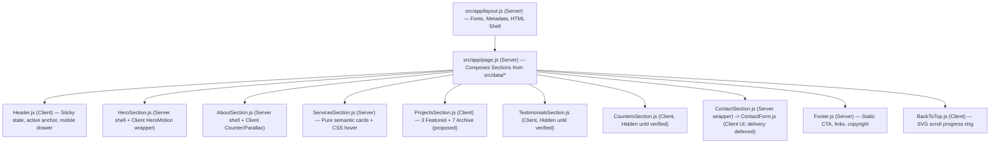
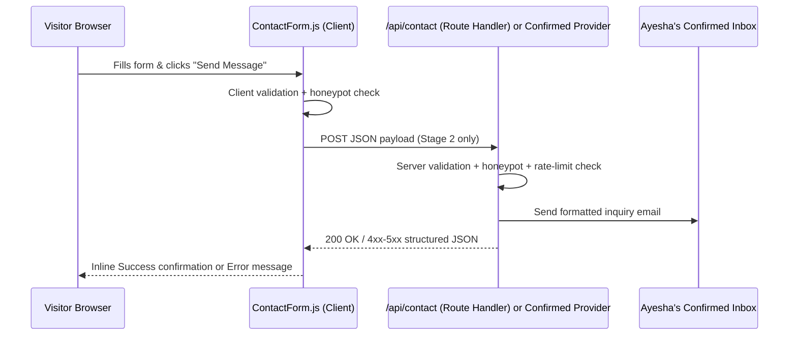

# Technical Architecture Specification

> **Stack Baseline:** Verified directly against the initialized repository (`package.json`, `next.config.mjs`, `jsconfig.json`, `eslint.config.mjs`, `src/app/`).  
> **Critical Rule (from root `AGENTS.md`):** This repository runs **Next.js 16.4.6**, which has breaking changes relative to older Next.js versions. Always verify APIs against `node_modules/next/dist/docs/` before writing code.

---

## 1. Verified Technology Baseline

The repository is already initialized with the following exact dependencies and configuration — **do not alter or add packages until explicitly approved**:

| Layer | Installed Package / Config | Exact Version / Setting | Architectural Notes |
| :--- | :--- | :--- | :--- |
| **Framework** | `next` | `16.4.6` | App Router under `src/app/`. `cacheComponents: true` and `partialPrefetching: true` enabled in `next.config.mjs`. |
| **UI Library** | `react` / `react-dom` | `19.3.0` | React Server Components (RSC) by default; `"use client"` strictly for interactive/animated leaves. |
| **Language** | JavaScript (ES Modules / JSX) | No TypeScript | Path alias `@/*` -> `./src/*` configured in `jsconfig.json`. Keep plain JS/JSX per `PROJECT_OVERVIEW.pdf` (p. 4). |
| **Styling** | `tailwindcss` + `@tailwindcss/turbopack` | `4.3.3` | Configured via Turbopack CSS loader in `next.config.mjs` and `@import "tailwindcss";` + `@theme inline` in `src/app/globals.css`. No `tailwind.config.js` file. |
| **Linting** | `eslint` + `eslint-config-next` | `^9` / `16.4.6` | Flat config in `eslint.config.mjs` extending `eslint-config-next/core-web-vitals`. |
| **Deployment** | Git + GitHub -> Vercel | Zero-config Next.js preset | Automatic preview deploys per PR and production deploy on `main`. |

### Reconciliation with `PROJECT_OVERVIEW.pdf`

`PROJECT_OVERVIEW.pdf` (p. 4–5) noted *"CSS Modules or custom CSS"* and `next.config.js`, whereas the initialized project already ships with **`next.config.mjs`** and **Tailwind CSS v4.3.3 (`@tailwindcss/turbopack`)**.  
**Architectural Decision:** Retain Tailwind CSS v4.3.3 for layout, spacing, responsive utilities, and token consumption via `@theme inline`, paired with scoped custom CSS rules in `src/app/globals.css` (or a small companion stylesheet `src/styles/ashik-effects.css`) for Ashik-specific keyframes (`slideDown`), timeline pseudo-element dots, left gradient fade masks, and scroll-progress rings. Do **not** install Bootstrap, jQuery, or third-party UI kits.

---

## 2. Rendering & Component Architecture

### 2.1 Server vs. Client Component Boundary

Because this is a single-page portfolio with static verified data and selective interactive islands, default to **Server Components** and push `"use client"` strictly to interactive boundaries:

### 2.2 Component Layering Strategy

1. **Layout Components (`src/components/layout/`):** Persistent structural chrome (`Header`, `MobileDrawer`, `Footer`, `BackToTop`). *Note: Ashik's fullscreen `Preloader` is omitted from the initial implementation (`CD-03`).*
2. **Section Components (`src/components/sections/`):** One dedicated module per page band (`HeroSection`, `AboutSection`, `ServicesSection`, `ProjectsSection`, `TestimonialsSection`, `CountersSection`, `ContactSection`), each receiving verified content from `src/data/` rather than hardcoding copy inline. `TestimonialsSection` and `CountersSection` remain hidden (`return null`) until verified content is supplied (`CD-02`).
3. **UI Primitives (`src/components/ui/`):** Reusable Ashik-faithful primitives (`Button`, `SectionHeading`, `ServiceCard`, `ProjectItem`, `SocialLinks`, `Icons`) ensuring consistent border radii, shadows, and hover transitions across the entire page.
4. **Data Layer (`src/data/`):** Pure JS modules (`profile.js`, `navigation.js`, `services.js`, `projects.js`, `testimonials.js`, `counters.js`) acting as the single verified content repository.

---

## 3. Styling & Asset Pipeline

### 3.1 Styling Architecture

- **Global Tokens (`src/app/globals.css`):** Define `:root` Ashik variables (proposed color direction pending `PD-01`) and Tailwind v4 `@theme inline` mappings (see [DESIGN_SYSTEM.md §5](./DESIGN_SYSTEM.md#5-tailwind-css-v4-token-integration-blueprint)).
- **Remove Starter Dark Mode:** Delete the `create-next-app` `@media (prefers-color-scheme: dark)` override in `src/app/globals.css` so dark-OS browsers render the light Ashik palette consistently.
- **Smooth Scrolling:** Use `scroll-behavior: smooth;` with `scroll-margin-top: 96px;` on every anchor `<section id="...">` so sticky header navigation never obscures section titles. Override `scroll-behavior: auto;` inside `@media (prefers-reduced-motion: reduce)`.

### 3.2 Fonts & Images

- **Fonts (`next/font/google`):** Load `Spline_Sans` (`weights: ["300", "400", "500", "600", "700"]`, `subsets: ["latin"]`, `display: "swap"`, `variable: "--font-spline-sans"`) in `src/app/layout.js`, replacing the starter `Geist` / `Geist_Mono` imports. Load `Poppins` only if used by a verified secondary element.
- **Images (`next/image`):**
  - Store all approved portraits and project screenshots locally under `public/images/` in WebP/AVIF (or high-res PNG/JPG automatically optimized by Next.js Image Optimization).
  - Mark the Hero portrait with `priority` (or `preload` per Next.js 16 `next/image` docs — verify in `node_modules/next/dist/docs/` before coding) to support strong Largest Contentful Paint (LCP).
  - Always specify explicit `width`/`height` or `fill` inside fixed aspect-ratio containers (`aspect-[3/2]`, `aspect-[4/5]`) with accurate `sizes` attributes to minimize layout shift and target near-zero CLS *(quality target, not a guarantee)*.
  - Never configure unapproved remote image domains or hotlink external assets.
- **Icons:** Render custom inline SVG React components (`src/components/ui/Icons.js`) matching Ashik's icon proportions. Zero external icon fonts (`Font Awesome Pro` / `ashik-icon.ttf`) and zero extra runtime packages.

---

## 4. Animation Strategy

Live Ashik uses GSAP + ScrollTrigger + ScrollSmoother + SplitText + jQuery CounterUp + Swiper. **Confirmed Decision (`CD-04`):** Do **not** install GSAP, Swiper, jQuery, Waypoints, or any additional packages at this stage.

### Initial-Build Motion Architecture (Zero Additional Packages)

| Mechanism | Scope of Use | External Bundle Cost |
| :--- | :--- | :--- |
| **CSS Transitions & Keyframes** | Sticky header `slideDown`, primary/secondary button fills, service card/arrow hover, Hero headline masked upward reveal, mobile drawer slide, CSS scroll-snap transitions, subtle desktop sticky layering. | **0 KB** |
| **Native `IntersectionObserver` + `requestAnimationFrame`** | Active navbar anchor highlighting, subtle section entrance reveals, circular SVG scroll-progress Back-to-Top ring, and smooth numeric count-up (once Counters are enabled with verified data). | **0 KB** |
| **Native CSS Scroll-Snap + React State** | Interactive stepped/horizontal presentation for featured Projects (if selected) and accessible Testimonials carousel (once verified testimonials are supplied). | **0 KB** |

### Motion Engineering Rules

1. **No Additional Motion/Carousel Libraries at This Stage:** Do not install `gsap`, `swiper`, `framer-motion`, `lenis`, or scroll-hijacking wrappers in the initial implementation.
2. **No SplitText Plugin Needed:** Recreate Ashik's Hero headline entrance cleanly with word/line `` wrappers and CSS `transform: translateY()` inside `overflow: hidden` masks.
3. **Strict Cleanup & Reduced Motion:** Every `addEventListener`, `IntersectionObserver`, and `requestAnimationFrame` loop inside `useEffect` must clean up on unmount, keep mobile layouts strictly vertical/unpinned below `992px`, and bypass non-essential motion under `window.matchMedia("(prefers-reduced-motion: reduce)")`.

---

## 5. Contact Form Architecture

### Confirmed Two-Stage Scope (`CD-05`)

- **Stage 1 — Initial Implementation (UI & Validation Only):** The Contact section visual layout, Ashik-styled white form card, accessible labels/focus rings, honeypot field, and frontend validation (`src/lib/validation.js`) may be prepared.
- **Stage 2 — Email Delivery (Unimplemented Until Confirmed — `PA-05`):** Live email dispatch (Route Handler or third-party provider integration) **must remain unimplemented** until Ayesha's destination email address and preferred delivery provider are confirmed. Do not wire mock endpoints or fake a "message sent" confirmation before delivery is implemented.

### Target Request Flow (Once Stage 2 Is Approved)

### Delivery Options to Evaluate (Pending Confirmation `PA-05`)

| Option | Mechanism | Pros | Cons / Requirements |
| :--- | :--- | :--- | :--- |
| **Option A: Next.js Route Handler + Resend (Proposed)** | `src/app/api/contact/route.js` calls Resend REST API (via native `fetch`, zero SDK required) using `RESEND_API_KEY` and `CONTACT_TO_EMAIL` env vars. | Full control over validation, response shape, and branding; keeps recipient email private on server; zero client-side third-party redirects. | Requires Resend account + verified sender domain + Vercel env vars. |
| **Option B: Managed Form Endpoint (Formspree / Web3Forms)** | Client `POST` to managed provider endpoint stored in `NEXT_PUBLIC_CONTACT_ENDPOINT`. | Zero server API code; fast setup; built-in spam dashboard. | External provider dependency & free-tier monthly submission limits. |

### Required Form Safeguards (Stage 1 Validation + Stage 2 Server Enforcement)

- **Validation:** Enforce non-empty `name` (`>= 2` chars), valid email format, non-empty `message` (`>= 10` chars), and reasonable max lengths (`name <= 100`, `subject <= 150`, `message <= 3000`).
- **Spam Protection:** Hidden honeypot field (e.g., `website`, ignored by humans via `tabIndex={-1}`, `autoComplete="off"`, `aria-hidden="true"`) + minimum submit timing check (`>= 2s` since mount) + server/provider rate limiting once Stage 2 is enabled.
- **Security:** Never expose private API keys in `NEXT_PUBLIC_*` variables; sanitize/escape user strings in HTML email templates once Stage 2 is implemented.

---

## 6. SEO, Performance Targets & Deployment Considerations

### 6.1 Metadata & Structured Data

Configure Next.js App Router `metadata` in `src/app/layout.js`:
- Accurate `<title>`: `"Ayesha Ahmad Khan — WordPress Developer & Elementor Expert"` (proposed, pending final sign-off).
- Concise `description`, `openGraph`, `twitter` card tags, and `icons` (favicon once supplied).
- Optional JSON-LD `Person` schema in `page.js` using strictly verified attributes (name, jobTitle, alumniOf: PUCIT, confirmed URLs).

### 6.2 Next.js 16 Configuration Awareness

- Keep `next.config.mjs` Turbopack CSS rules intact (`@tailwindcss/turbopack`).
- Because `cacheComponents: true` is currently enabled in `next.config.mjs`, ensure any future Route Handler (`/api/contact` in Stage 2) follows Next.js 16 caching semantics (consult `node_modules/next/dist/docs/` before implementing).
- Consider setting `images: { formats: ["image/avif", "image/webp"] }` in `next.config.mjs` during Phase 1 to support strong image compression.

### 6.3 Vercel Deployment Pipeline

1. **Environment Variables (Stage 2 — Vercel Project Settings):** Once Contact email delivery is confirmed and implemented, store provider secrets (`RESEND_API_KEY`, `CONTACT_TO_EMAIL`, `CONTACT_FROM_EMAIL`, or `NEXT_PUBLIC_CONTACT_ENDPOINT`) in Vercel Preview & Production environments — never commit `.env.local` to Git.
2. **Pre-Deploy Quality Gates:** Run `npm run lint` and `npm run build` locally before merging to `main`.
3. **Production Quality Audits:** Verify custom domain DNS/HTTPS (if provided), verify Open Graph preview cards, measure desktop/mobile performance against quality targets (Lighthouse Performance `>= 90`, minimal CLS, WCAG AA accessibility), and test live contact email delivery end-to-end once Stage 2 is enabled.
